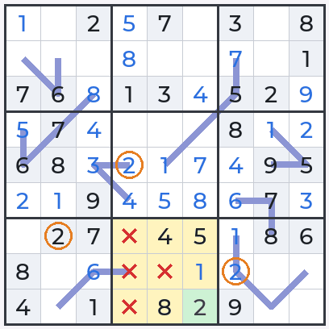

<!-- Written by tools/walkthrough.py sequence-lines: edit the script, not this page. -->
# Sequence Lines, step 28: the 2 in box 8

**Step 28 of 51** · [← Step 27](step-27.md) · [All steps](../sequence-lines.md#the-whole-puzzle-step-by-step) · [Step 29 →](step-29.md)

Box 8 needs a 2. r7c4: row 7 has one (r7c2). r8c4 and r8c5: row 8 has one (r8c7). r9c4: column 4 has one (r5c4). Only **r9c6** is left: **r9c6 = 2**.

**Step 28 of 51** · [← Step 27](step-27.md) · [All steps](../sequence-lines.md#the-whole-puzzle-step-by-step) · [Step 29 →](step-29.md)
