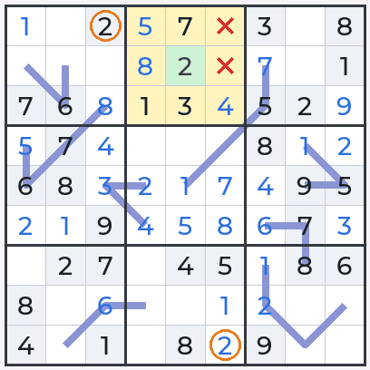

<!-- Written by tools/walkthrough.py sequence-lines: edit the script, not this page. -->
# Sequence Lines, step 29: the 2 in box 2

**Step 29 of 51** · [← Step 28](step-28.md) · [All steps](../sequence-lines.md#the-whole-puzzle-step-by-step) · [Step 30 →](step-30.md)

Box 2 needs a 2. r1c6: row 1 has one (r1c3). r2c6: column 6 has one (r9c6). Only **r2c5** is left: **r2c5 = 2**.

**Step 29 of 51** · [← Step 28](step-28.md) · [All steps](../sequence-lines.md#the-whole-puzzle-step-by-step) · [Step 30 →](step-30.md)
