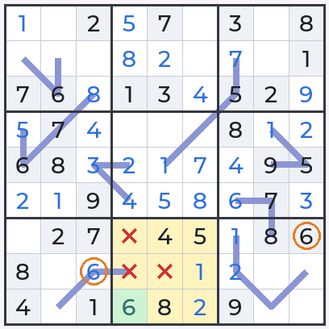

<!-- Written by tools/walkthrough.py sequence-lines: edit the script, not this page. -->
# Sequence Lines, step 30: the 6 in box 8

**Step 30 of 51** · [← Step 29](step-29.md) · [All steps](../sequence-lines.md#the-whole-puzzle-step-by-step) · [Step 31 →](step-31.md)

Box 8 needs a 6. r7c4: row 7 has one (r7c9). r8c4 and r8c5: row 8 has one (r8c3). Only **r9c4** is left: **r9c4 = 6**.

**Step 30 of 51** · [← Step 29](step-29.md) · [All steps](../sequence-lines.md#the-whole-puzzle-step-by-step) · [Step 31 →](step-31.md)
