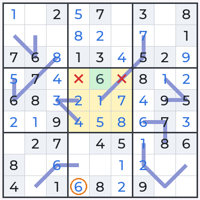

<!-- Written by tools/walkthrough.py sequence-lines: edit the script, not this page. -->
# Sequence Lines, step 31: the 6 in box 5

**Step 31 of 51** · [← Step 30](step-30.md) · [All steps](../sequence-lines.md#the-whole-puzzle-step-by-step) · [Step 32 →](step-32.md)

Box 5 needs a 6. r4c4: column 4 has one (r9c4). r4c6: the 7 in r2c7 and the 5 in r3c7 on its indigo line make a step of -2, so it's 3. Only **r4c5** is left: **r4c5 = 6**.

**Step 31 of 51** · [← Step 30](step-30.md) · [All steps](../sequence-lines.md#the-whole-puzzle-step-by-step) · [Step 32 →](step-32.md)
