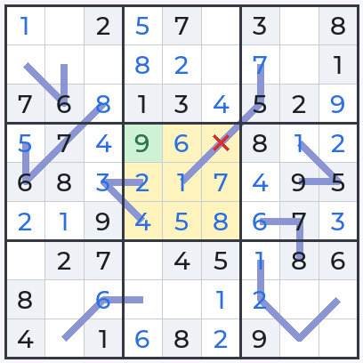

<!-- Written by tools/walkthrough.py sequence-lines: edit the script, not this page. -->
# Sequence Lines, step 32: the 9 in box 5

**Step 32 of 51** · [← Step 31](step-31.md) · [All steps](../sequence-lines.md#the-whole-puzzle-step-by-step) · [Step 33 →](step-33.md)

Box 5 needs a 9. r4c6: the 7 in r2c7 and the 5 in r3c7 on its indigo line make a step of -2, so it's 3. Only **r4c4** is left: **r4c4 = 9**.

**Step 32 of 51** · [← Step 31](step-31.md) · [All steps](../sequence-lines.md#the-whole-puzzle-step-by-step) · [Step 33 →](step-33.md)
