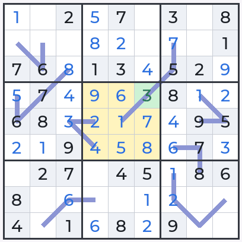

<!-- Written by tools/walkthrough.py sequence-lines: edit the script, not this page. -->
# Sequence Lines, step 33: the 3 in box 5

**Step 33 of 51** · [← Step 32](step-32.md) · [All steps](../sequence-lines.md#the-whole-puzzle-step-by-step) · [Step 34 →](step-34.md)

Box 5 needs a 3, and r4c6 is its last empty cell: **r4c6 = 3**.

**Step 33 of 51** · [← Step 32](step-32.md) · [All steps](../sequence-lines.md#the-whole-puzzle-step-by-step) · [Step 34 →](step-34.md)
