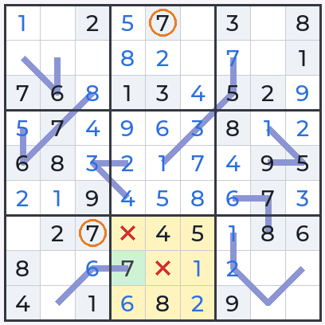

<!-- Written by tools/walkthrough.py sequence-lines: edit the script, not this page. -->
# Sequence Lines, step 34: the 7 in box 8

**Step 34 of 51** · [← Step 33](step-33.md) · [All steps](../sequence-lines.md#the-whole-puzzle-step-by-step) · [Step 35 →](step-35.md)

Box 8 needs a 7. r7c4: row 7 has one (r7c3). r8c5: column 5 has one (r1c5). Only **r8c4** is left: **r8c4 = 7**.

**Step 34 of 51** · [← Step 33](step-33.md) · [All steps](../sequence-lines.md#the-whole-puzzle-step-by-step) · [Step 35 →](step-35.md)
