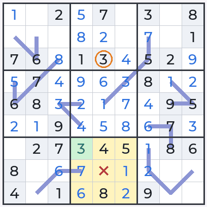

<!-- Written by tools/walkthrough.py sequence-lines: edit the script, not this page. -->
# Sequence Lines, step 35: the 3 in box 8

**Step 35 of 51** · [← Step 34](step-34.md) · [All steps](../sequence-lines.md#the-whole-puzzle-step-by-step) · [Step 36 →](step-36.md)

Box 8 needs a 3. r8c5: column 5 has one (r3c5). Only **r7c4** is left: **r7c4 = 3**.

**Step 35 of 51** · [← Step 34](step-34.md) · [All steps](../sequence-lines.md#the-whole-puzzle-step-by-step) · [Step 36 →](step-36.md)
