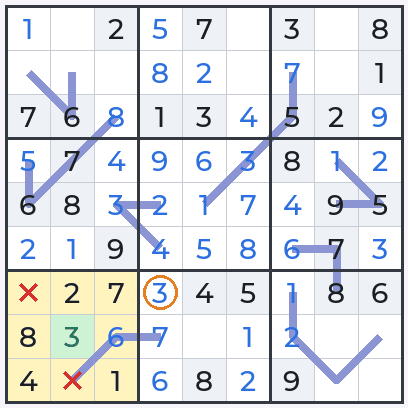

<!-- Written by tools/walkthrough.py sequence-lines: edit the script, not this page. -->
# Sequence Lines, step 36: the 3 in box 7

**Step 36 of 51** · [← Step 35](step-35.md) · [All steps](../sequence-lines.md#the-whole-puzzle-step-by-step) · [Step 37 →](step-37.md)

Box 7 needs a 3. r7c1: row 7 has one (r7c4). r9c2: the 6 in r8c3 and the 7 in r8c4 on its indigo line make a step of 1, so it's 5. Only **r8c2** is left: **r8c2 = 3**.

**Step 36 of 51** · [← Step 35](step-35.md) · [All steps](../sequence-lines.md#the-whole-puzzle-step-by-step) · [Step 37 →](step-37.md)
