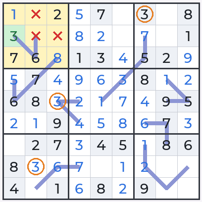

<!-- Written by tools/walkthrough.py sequence-lines: edit the script, not this page. -->
# Sequence Lines, step 37: the 3 in box 1

**Step 37 of 51** · [← Step 36](step-36.md) · [All steps](../sequence-lines.md#the-whole-puzzle-step-by-step) · [Step 38 →](step-38.md)

Box 1 needs a 3. r1c2: row 1 has one (r1c7). r2c2: column 2 has one (r8c2). r2c3: column 3 has one (r5c3). Only **r2c1** is left: **r2c1 = 3**.

**Step 37 of 51** · [← Step 36](step-36.md) · [All steps](../sequence-lines.md#the-whole-puzzle-step-by-step) · [Step 38 →](step-38.md)
