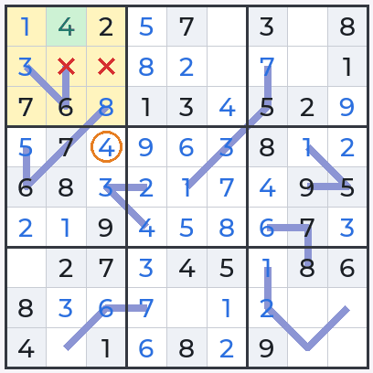

<!-- Written by tools/walkthrough.py sequence-lines: edit the script, not this page. -->
# Sequence Lines, step 38: the 4 in box 1

**Step 38 of 51** · [← Step 37](step-37.md) · [All steps](../sequence-lines.md#the-whole-puzzle-step-by-step) · [Step 39 →](step-39.md)

Box 1 needs a 4. r2c3: column 3 has one (r4c3). r2c2: the 3 in r2c1 and the 6 in r3c2 on its indigo line make a step of 3, so it's 9. Only **r1c2** is left: **r1c2 = 4**.

**Step 38 of 51** · [← Step 37](step-37.md) · [All steps](../sequence-lines.md#the-whole-puzzle-step-by-step) · [Step 39 →](step-39.md)
