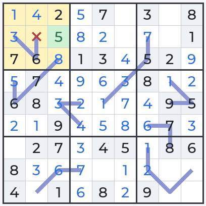

<!-- Written by tools/walkthrough.py sequence-lines: edit the script, not this page. -->
# Sequence Lines, step 39: the 5 in box 1

**Step 39 of 51** · [← Step 38](step-38.md) · [All steps](../sequence-lines.md#the-whole-puzzle-step-by-step) · [Step 40 →](step-40.md)

Box 1 needs a 5. r2c2: the 3 in r2c1 and the 6 in r3c2 on its indigo line make a step of 3, so it's 9. Only **r2c3** is left: **r2c3 = 5**.

**Step 39 of 51** · [← Step 38](step-38.md) · [All steps](../sequence-lines.md#the-whole-puzzle-step-by-step) · [Step 40 →](step-40.md)
