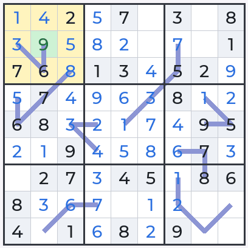

<!-- Written by tools/walkthrough.py sequence-lines: edit the script, not this page. -->
# Sequence Lines, step 40: the 9 in box 1

**Step 40 of 51** · [← Step 39](step-39.md) · [All steps](../sequence-lines.md#the-whole-puzzle-step-by-step) · [Step 41 →](step-41.md)

Box 1 needs a 9, and r2c2 is its last empty cell: **r2c2 = 9**.

**Step 40 of 51** · [← Step 39](step-39.md) · [All steps](../sequence-lines.md#the-whole-puzzle-step-by-step) · [Step 41 →](step-41.md)
