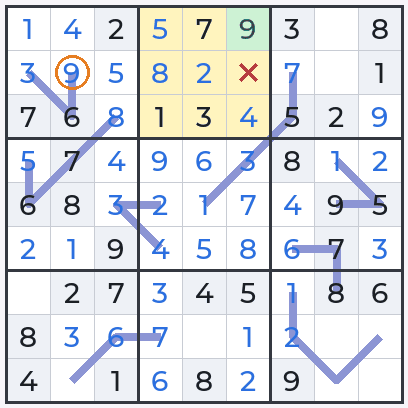

<!-- Written by tools/walkthrough.py sequence-lines: edit the script, not this page. -->
# Sequence Lines, step 41: the 9 in box 2

**Step 41 of 51** · [← Step 40](step-40.md) · [All steps](../sequence-lines.md#the-whole-puzzle-step-by-step) · [Step 42 →](step-42.md)

Box 2 needs a 9. r2c6: row 2 has one (r2c2). Only **r1c6** is left: **r1c6 = 9**.

**Step 41 of 51** · [← Step 40](step-40.md) · [All steps](../sequence-lines.md#the-whole-puzzle-step-by-step) · [Step 42 →](step-42.md)
