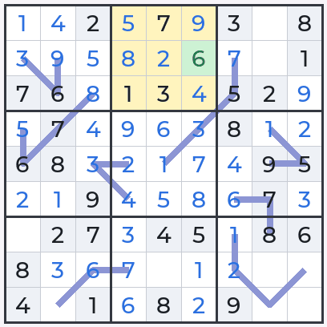

<!-- Written by tools/walkthrough.py sequence-lines: edit the script, not this page. -->
# Sequence Lines, step 42: the 6 in box 2

**Step 42 of 51** · [← Step 41](step-41.md) · [All steps](../sequence-lines.md#the-whole-puzzle-step-by-step) · [Step 43 →](step-43.md)

Box 2 needs a 6, and r2c6 is its last empty cell: **r2c6 = 6**.

**Step 42 of 51** · [← Step 41](step-41.md) · [All steps](../sequence-lines.md#the-whole-puzzle-step-by-step) · [Step 43 →](step-43.md)
