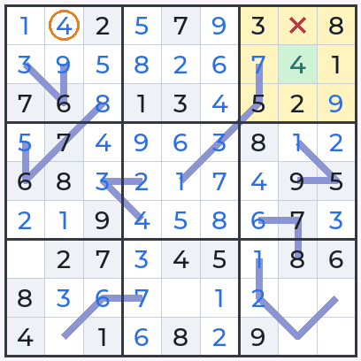

<!-- Written by tools/walkthrough.py sequence-lines: edit the script, not this page. -->
# Sequence Lines, step 43: the 4 in box 3

**Step 43 of 51** · [← Step 42](step-42.md) · [All steps](../sequence-lines.md#the-whole-puzzle-step-by-step) · [Step 44 →](step-44.md)

Box 3 needs a 4. r1c8: row 1 has one (r1c2). Only **r2c8** is left: **r2c8 = 4**.

**Step 43 of 51** · [← Step 42](step-42.md) · [All steps](../sequence-lines.md#the-whole-puzzle-step-by-step) · [Step 44 →](step-44.md)
