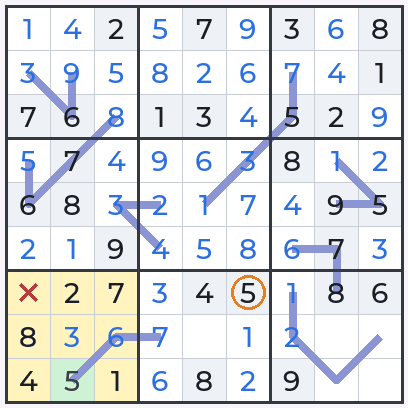

<!-- Written by tools/walkthrough.py sequence-lines: edit the script, not this page. -->
# Sequence Lines, step 45: the 5 in box 7

**Step 45 of 51** · [← Step 44](step-44.md) · [All steps](../sequence-lines.md#the-whole-puzzle-step-by-step) · [Step 46 →](step-46.md)

Box 7 needs a 5. r7c1: row 7 has one (r7c6). Only **r9c2** is left: **r9c2 = 5**.

**Step 45 of 51** · [← Step 44](step-44.md) · [All steps](../sequence-lines.md#the-whole-puzzle-step-by-step) · [Step 46 →](step-46.md)
