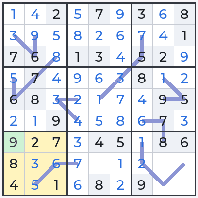

<!-- Written by tools/walkthrough.py sequence-lines: edit the script, not this page. -->
# Sequence Lines, step 46: the 9 in box 7

**Step 46 of 51** · [← Step 45](step-45.md) · [All steps](../sequence-lines.md#the-whole-puzzle-step-by-step) · [Step 47 →](step-47.md)

Box 7 needs a 9, and r7c1 is its last empty cell: **r7c1 = 9**.

**Step 46 of 51** · [← Step 45](step-45.md) · [All steps](../sequence-lines.md#the-whole-puzzle-step-by-step) · [Step 47 →](step-47.md)
