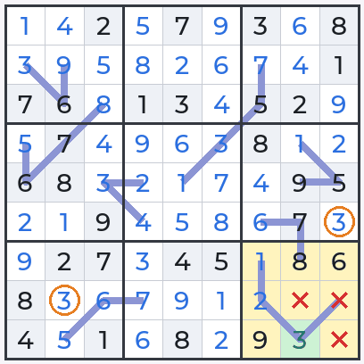

<!-- Written by tools/walkthrough.py sequence-lines: edit the script, not this page. -->
# Sequence Lines, step 48: the 3 in box 9

**Step 48 of 51** · [← Step 47](step-47.md) · [All steps](../sequence-lines.md#the-whole-puzzle-step-by-step) · [Step 49 →](step-49.md)

Box 9 needs a 3. r8c8 and r8c9: row 8 has one (r8c2). r9c9: column 9 has one (r6c9). Only **r9c8** is left: **r9c8 = 3**.

**Step 48 of 51** · [← Step 47](step-47.md) · [All steps](../sequence-lines.md#the-whole-puzzle-step-by-step) · [Step 49 →](step-49.md)
