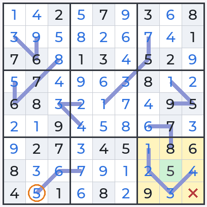

<!-- Written by tools/walkthrough.py sequence-lines: edit the script, not this page. -->
# Sequence Lines, step 50: the 5 in box 9

**Step 50 of 51** · [← Step 49](step-49.md) · [All steps](../sequence-lines.md#the-whole-puzzle-step-by-step) · [Step 51 →](step-51.md)

Box 9 needs a 5. r9c9: row 9 has one (r9c2). Only **r8c8** is left: **r8c8 = 5**.

**Step 50 of 51** · [← Step 49](step-49.md) · [All steps](../sequence-lines.md#the-whole-puzzle-step-by-step) · [Step 51 →](step-51.md)
