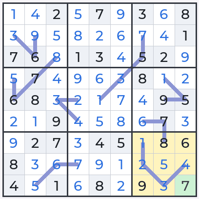

<!-- Written by tools/walkthrough.py sequence-lines: edit the script, not this page. -->
# Sequence Lines, step 51: the 7 in box 9

**Step 51 of 51** · [← Step 50](step-50.md) · [All steps](../sequence-lines.md#the-whole-puzzle-step-by-step) · [All steps](../sequence-lines.md#the-whole-puzzle-step-by-step)

Box 9 needs a 7, and r9c9 is its last empty cell: **r9c9 = 7**.

Solved.

**Step 51 of 51** · [← Step 50](step-50.md) · [All steps](../sequence-lines.md#the-whole-puzzle-step-by-step) · [All steps](../sequence-lines.md#the-whole-puzzle-step-by-step)
