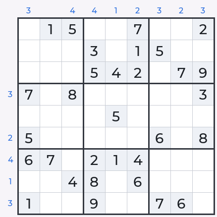

# Skyscraper

[← All variants](README.md) · [Puzzles](../features-puzzles.md) · [How to play](../how-to-play.md)

## The rules

[Classic](classic.md) rules, and **clues** left of some rows and above some columns. Think of each digit as a building that many floors tall: a clue says **how many buildings are seen** from there, looking along the row (from the left) or down the column (from the top). A taller building hides every shorter one behind it. In 2, 5, 1, 9, 8 you see 2, 5 and 9: three buildings. A line without a clue has no such rule.

## On the board

- The clues are in blue in a margin left of the rows and above the columns; a line without a clue has none.
- A line that already shows more buildings than its clue, or (with its 9 placed, or full) not exactly its clue, turns red.
- The grader and hints use each clue twice: it limits how tall the first buildings can be, and once a clue's line is nearly full, only the arrangements that show the clue are left ("From the clue of row 7, 4 buildings are seen ...").
- **Puzzles → ⋮ → New puzzle → Skyscraper**: about three quarters of the lines have a clue (Hard and Expert: about 60 %).

## How to solve it

- **Clue 1:** only one building is seen, so the first cell is the 9.
- **Clue 9:** every building is seen, so the line is 1, 2, 3, ... 9 in order.
- **The 9 hides everything behind it,** so the buildings seen are the ones up to the 9. With a clue of c, the 9 is at least c cells in.
- **Small clues, tall first buildings; big clues, short ones:** the k-th cell from a clue of c is at most k + 9 − c (counting the first cell as 1). With a clue of 4, the first cell is at most 6.
- When a line is nearly full, try the missing digits in each order and keep the orders that show the clue.

## Worked example

**variant-examples #24**, Skyscraper Easy (see [Classic](classic.md#worked-example-the-whole-puzzle) for how to import the examples; cells are written r*row*c*column*). The clues are in the screenshot; from the left, row 7's is **4** and row 8's is **1**.

**Step 1: r7c3, row 7 (clue 4).** Row 7 has 6, 7, 2, 1 and 4; column 3 has 5 and 8. By the Classic rules r7c3 could be 3 or 9. Row 7 starts 6, 7: two buildings seen. A 9 in r7c3 would be the third, and it would hide everything behind it: only 3 seen, not 4. **r7c3 = 3**.

**Step 2: r7c7, row 7 again.** Row 7 now reads 6, 7, 3, 2, 1, 4, then three empty cells; r7c7 could be 8 or 9 (column 7 has a 5, the row the rest). A 9 there would again stop the count at 6, 7, 9: three. With an 8, the row shows 6, 7, 8 and then the 9 behind it: four. **r7c7 = 8**.

**Step 3: r8c1, row 8 (clue 1).** Only one building is seen from the left of row 8, so the first one must be the tallest: **r8c1 = 9**.

## The whole puzzle, step by step

<!-- walkthrough -->
<!-- Written by tools/walkthrough.py skyscraper: edit the script, not this part. -->

The whole puzzle, from the start to the last cell: 50 steps, each one a single (one place left for a digit, or one digit left for a cell), taken in the order a box's single comes first, so not quite the order of the worked example above. Each step has a page of its own, with **Previous** and **Next**: pick one from the list below. In each picture, the unit the step looks at is tinted yellow (for a cell with one digit left: its row, column and box), the new digit is on green, the digits that rule cells out have an **orange ring**, and the empty cells they rule out a **red cross**. Givens are on grey, digits from earlier steps in blue.

1. [the 7 in box 1](skyscraper/step-01.md)
2. [the 9 in box 1](skyscraper/step-02.md)
3. [the 2 in box 1](skyscraper/step-03.md)
4. [the 4 in box 1](skyscraper/step-04.md)
5. [the 8 in box 2](skyscraper/step-05.md)
6. [the 6 in box 2](skyscraper/step-06.md)
7. [the 9 in box 2](skyscraper/step-07.md)
8. [the 1 in box 3](skyscraper/step-08.md)
9. [the 6 in box 3](skyscraper/step-09.md)
10. [the 4 in box 3](skyscraper/step-10.md)
11. [the 3 in box 3](skyscraper/step-11.md)
12. [the 8 in box 3](skyscraper/step-12.md)
13. [the 6 in box 5](skyscraper/step-13.md)
14. [the 2 in box 5](skyscraper/step-14.md)
15. [the 8 in box 5](skyscraper/step-15.md)
16. [the 3 in box 5](skyscraper/step-16.md)
17. [the 9 in box 5](skyscraper/step-17.md)
18. [the 5 in box 6](skyscraper/step-18.md)
19. [the 7 in box 6](skyscraper/step-19.md)
20. [the 7 in box 5](skyscraper/step-20.md)
21. [the 8 in box 7](skyscraper/step-21.md)
22. [the 8 in box 1](skyscraper/step-22.md)
23. [the 5 in box 7](skyscraper/step-23.md)
24. [the 2 in box 7](skyscraper/step-24.md)
25. [the 3 in box 7](skyscraper/step-25.md)
26. [the 3 in box 1](skyscraper/step-26.md)
27. [the 6 in box 1](skyscraper/step-27.md)
28. [the 3 in box 4](skyscraper/step-28.md)
29. [the 6 in box 4](skyscraper/step-29.md)
30. [the 2 in box 4](skyscraper/step-30.md)
31. [the 4 in box 4](skyscraper/step-31.md)
32. [the 1 in box 4](skyscraper/step-32.md)
33. [the 9 in box 4](skyscraper/step-33.md)
34. [the 1 in box 5](skyscraper/step-34.md)
35. [the 4 in box 5](skyscraper/step-35.md)
36. [the 1 in box 6](skyscraper/step-36.md)
37. [the 4 in box 6](skyscraper/step-37.md)
38. [the 2 in box 6](skyscraper/step-38.md)
39. [the 9 in box 6](skyscraper/step-39.md)
40. [the 9 in box 7](skyscraper/step-40.md)
41. [the 5 in box 8](skyscraper/step-41.md)
42. [the 7 in box 8](skyscraper/step-42.md)
43. [the 3 in box 8](skyscraper/step-43.md)
44. [the 1 in box 9](skyscraper/step-44.md)
45. [the 2 in box 9](skyscraper/step-45.md)
46. [the 3 in box 9](skyscraper/step-46.md)
47. [the 4 in box 9](skyscraper/step-47.md)
48. [the 5 in box 9](skyscraper/step-48.md)
49. [the 8 in box 9](skyscraper/step-49.md)
50. [the 9 in box 9](skyscraper/step-50.md)

Solved.

<!-- /walkthrough -->
