# Skyscraper

[← All variants](README.md) · [Puzzles](../features-puzzles.md) · [How to play](../how-to-play.md)

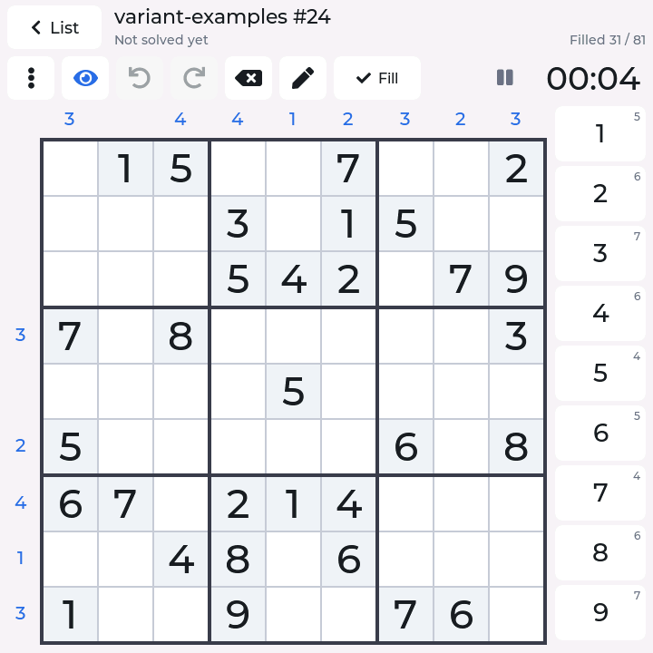

## The rules

[Classic](classic.md) rules, and **clues** left of some rows and above some columns. Think of each digit as a building that many floors tall: a clue says **how many buildings are seen** from there, looking along the row (from the left) or down the column (from the top). A taller building hides every shorter one behind it. In 2, 5, 1, 9, 8 you see 2, 5 and 9: three buildings. A line without a clue has no such rule.

## On the board

- The clues are in blue in a margin left of the rows and above the columns; a line without a clue has none.
- A line that already shows more buildings than its clue, or (with its 9 placed, or full) not exactly its clue, turns red.
- The grader and hints use each clue twice: it limits how tall the first buildings can be, and once a clue's line is nearly full, only the arrangements that show the clue are left ("From the clue of row 7, 4 buildings are seen ...").
- **Puzzles → ⋮ → New puzzle → Skyscraper**: about three quarters of the lines have a clue (Hard and Expert: about 60 %).

## How to solve it

- **Clue 1:** only one building is seen, so the first cell is the 9.
- **Clue 9:** every building is seen, so the line is 1, 2, 3, ... 9 in order.
- **The 9 hides everything behind it,** so the buildings seen are the ones up to the 9. With a clue of c, the 9 is at least c cells in.
- **Small clues, tall first buildings; big clues, short ones:** the k-th cell from a clue of c is at most k + 9 − c (counting the first cell as 1). With a clue of 4, the first cell is at most 6.
- When a line is nearly full, try the missing digits in each order and keep the orders that show the clue.

## Worked example

**variant-examples #24**, Skyscraper Easy (see [Classic](classic.md#worked-example-the-whole-puzzle) for how to import the examples; cells are written r*row*c*column*). The clues are in the screenshot; from the left, row 7's is **4** and row 8's is **1**.

**Step 1: r7c3, row 7 (clue 4).** Row 7 has 6, 7, 2, 1 and 4; column 3 has 5 and 8. By the Classic rules r7c3 could be 3 or 9. Row 7 starts 6, 7: two buildings seen. A 9 in r7c3 would be the third, and it would hide everything behind it: only 3 seen, not 4. **r7c3 = 3**.

**Step 2: r7c7, row 7 again.** Row 7 now reads 6, 7, 3, 2, 1, 4, then three empty cells; r7c7 could be 8 or 9 (column 7 has a 5, the row the rest). A 9 there would again stop the count at 6, 7, 9: three. With an 8, the row shows 6, 7, 8 and then the 9 behind it: four. **r7c7 = 8**.

**Step 3: r8c1, row 8 (clue 1).** Only one building is seen from the left of row 8, so the first one must be the tallest: **r8c1 = 9**.

## The whole puzzle, step by step

<!-- walkthrough -->
<!-- Written by tools/walkthrough.py skyscraper: edit the script, not this part. -->

The whole puzzle, from the start to the last cell: 50 steps, each one a single (one place left for a digit, or one digit left for a cell), taken in the order a box's single comes first, so not quite the order of the worked example above. In each picture, the unit the step looks at is tinted yellow (for a cell with one digit left: its row, column and box), the new digit is on green, the digits that rule cells out have an **orange ring**, and the empty cells they rule out a **red cross**. Givens are on grey, digits from earlier steps in blue.

#### Step 1: the 7 in box 1

Box 1 needs a 7. r1c1: row 1 has one (r1c6). r2c1: column 1 has one (r4c1). r2c2: column 2 has one (r7c2). r3c1, r3c2 and r3c3: row 3 has one (r3c8). Only **r2c3** is left: **r2c3 = 7**.

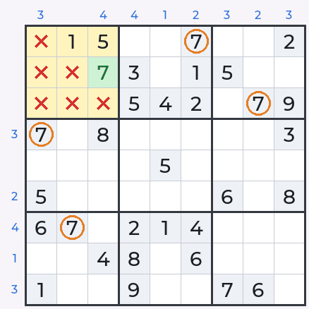

#### Step 2: the 9 in box 1

Box 1 needs a 9. r3c1, r3c2 and r3c3: row 3 has one (r3c9). r1c1: it's near a clue of its row or column, which keeps it at most 7. r2c1: it's near a clue of its row or column, which keeps it at most 8. Only **r2c2** is left: **r2c2 = 9**.

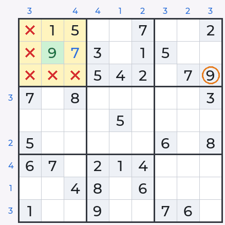

#### Step 3: the 2 in box 1

Box 1 needs a 2. r1c1: row 1 has one (r1c9). r3c1, r3c2 and r3c3: row 3 has one (r3c6). Only **r2c1** is left: **r2c1 = 2**.

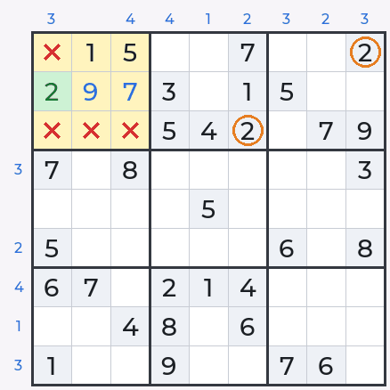

#### Step 4: the 4 in box 1

Box 1 needs a 4. r3c1, r3c2 and r3c3: row 3 has one (r3c5). Only **r1c1** is left: **r1c1 = 4**.

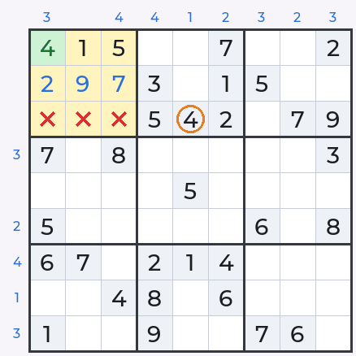

#### Step 5: the 8 in box 2

Box 2 needs an 8. r1c4: column 4 has one (r8c4). r1c5: a clue of its row or column makes it a 9 (see the rules above). Only **r2c5** is left: **r2c5 = 8**.

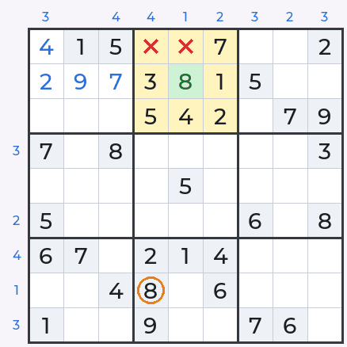

#### Step 6: the 6 in box 2

Box 2 needs a 6. r1c5: a clue of its row or column makes it a 9 (see the rules above). Only **r1c4** is left: **r1c4 = 6**.

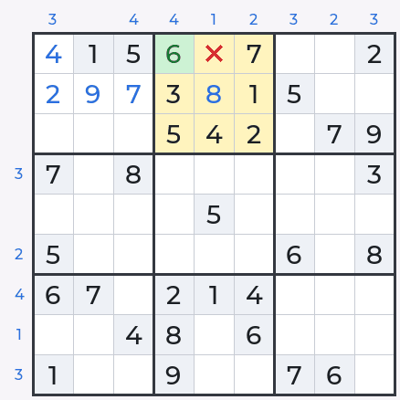

#### Step 7: the 9 in box 2

Box 2 needs a 9, and r1c5 is its last empty cell: **r1c5 = 9**.

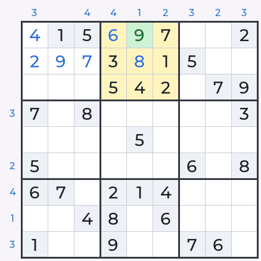

#### Step 8: the 1 in box 3

Box 3 needs a 1. r1c7 and r1c8: row 1 has one (r1c2). r2c8 and r2c9: row 2 has one (r2c6). Only **r3c7** is left: **r3c7 = 1**.

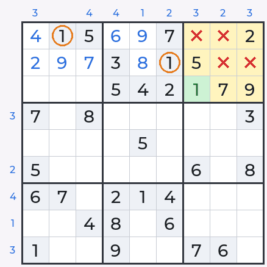

#### Step 9: the 6 in box 3

Box 3 needs a 6. r1c7 and r1c8: row 1 has one (r1c4). r2c8: column 8 has one (r9c8). Only **r2c9** is left: **r2c9 = 6**.

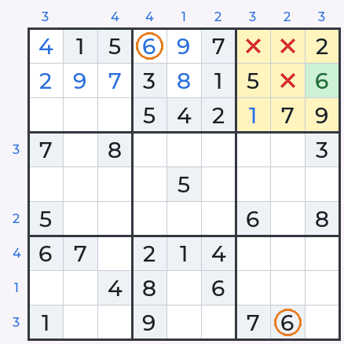

#### Step 10: the 4 in box 3

Box 3 needs a 4. r1c7 and r1c8: row 1 has one (r1c1). Only **r2c8** is left: **r2c8 = 4**.

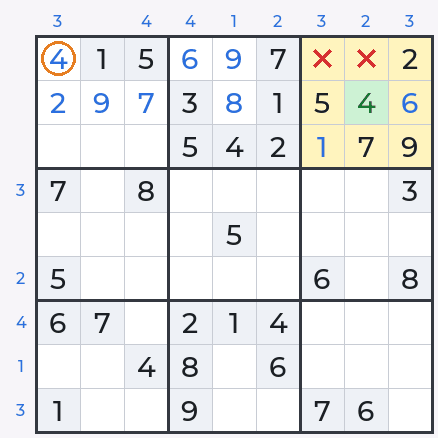

#### Step 11: the 3 in box 3

Box 3 needs a 3. r1c8: seen from the top of column 8, a 3 there would leave 3, 4 and 7 seen and the 9 still to come, more than its clue 2. Only **r1c7** is left: **r1c7 = 3**.

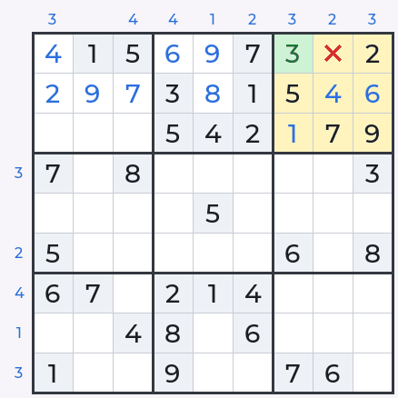

#### Step 12: the 8 in box 3

Box 3 needs an 8, and r1c8 is its last empty cell: **r1c8 = 8**.

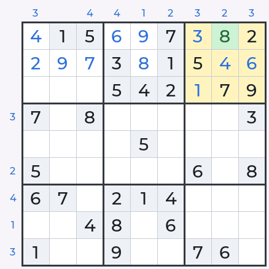

#### Step 13: the 6 in box 5

Box 5 needs a 6. r4c4 and r5c4: column 4 has one (r1c4). r4c6 and r5c6: column 6 has one (r8c6). r6c4, r6c5 and r6c6: row 6 has one (r6c7). Only **r4c5** is left: **r4c5 = 6**.

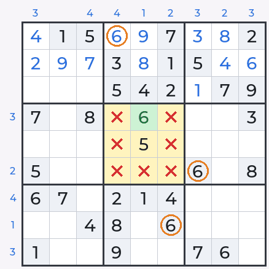

#### Step 14: the 2 in box 5

Box 5 needs a 2. r4c4, r5c4 and r6c4: column 4 has one (r7c4). r4c6, r5c6 and r6c6: column 6 has one (r3c6). Only **r6c5** is left: **r6c5 = 2**.

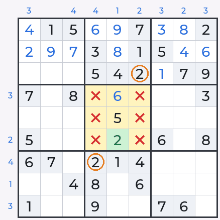

#### Step 15: the 8 in box 5

Box 5 needs an 8. r4c4 and r4c6: row 4 has one (r4c3). r5c4: column 4 has one (r8c4). r6c4 and r6c6: row 6 has one (r6c9). Only **r5c6** is left: **r5c6 = 8**.

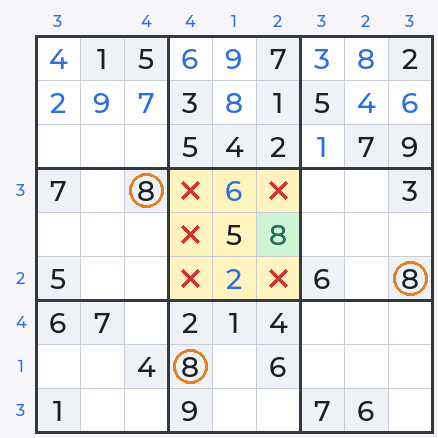

#### Step 16: the 3 in box 5

Box 5 needs a 3. r4c4 and r4c6: row 4 has one (r4c9). r5c4 and r6c4: column 4 has one (r2c4). Only **r6c6** is left: **r6c6 = 3**.

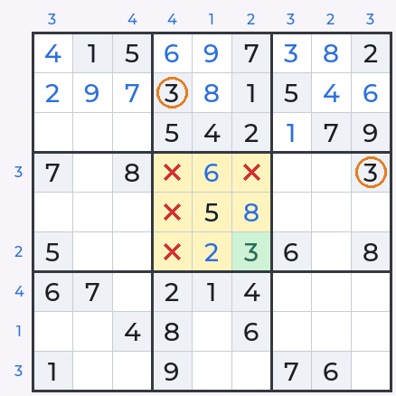

#### Step 17: the 9 in box 5

Box 5 needs a 9. r4c4, r5c4 and r6c4: column 4 has one (r9c4). Only **r4c6** is left: **r4c6 = 9**.

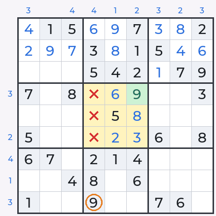

#### Step 18: the 5 in box 6

Box 6 needs a 5. r4c7: column 7 has one (r2c7). r5c7, r5c8 and r5c9: row 5 has one (r5c5). r6c8: row 6 has one (r6c1). Only **r4c8** is left: **r4c8 = 5**.

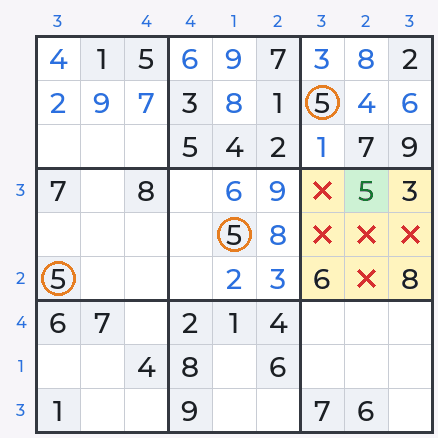

#### Step 19: the 7 in box 6

Box 6 needs a 7. r4c7: row 4 has one (r4c1). r5c7: column 7 has one (r9c7). r5c8 and r6c8: column 8 has one (r3c8). Only **r5c9** is left: **r5c9 = 7**.

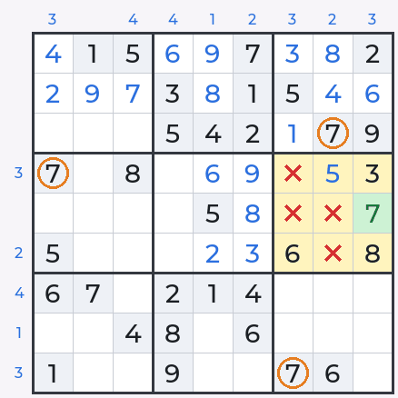

#### Step 20: the 7 in box 5

Box 5 needs a 7. r4c4: row 4 has one (r4c1). r5c4: row 5 has one (r5c9). Only **r6c4** is left: **r6c4 = 7**.

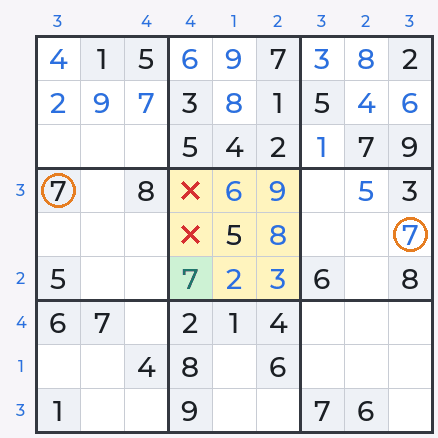

#### Step 21: the 8 in box 7

Box 7 needs an 8. r7c3 and r9c3: column 3 has one (r4c3). r8c1 and r8c2: row 8 has one (r8c4). Only **r9c2** is left: **r9c2 = 8**.

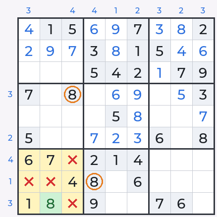

#### Step 22: the 8 in box 1

Box 1 needs an 8. r3c2: column 2 has one (r9c2). r3c3: column 3 has one (r4c3). Only **r3c1** is left: **r3c1 = 8**.

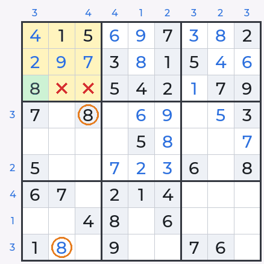

#### Step 23: the 5 in box 7

Box 7 needs a 5. r7c3 and r9c3: column 3 has one (r1c3). r8c1: column 1 has one (r6c1). Only **r8c2** is left: **r8c2 = 5**.

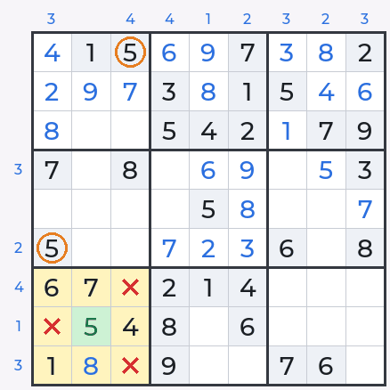

#### Step 24: the 2 in box 7

Box 7 needs a 2. r7c3: row 7 has one (r7c4). r8c1: column 1 has one (r2c1). Only **r9c3** is left: **r9c3 = 2**.

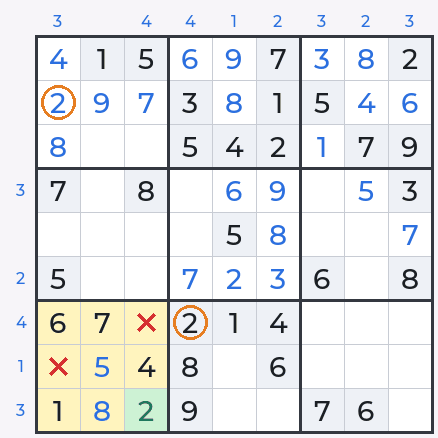

#### Step 25: the 3 in box 7

Box 7 needs a 3. r8c1: a clue of its row or column makes it a 9 (see the rules above). Only **r7c3** is left: **r7c3 = 3**.

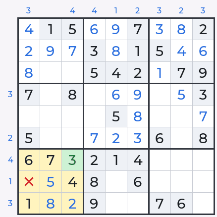

#### Step 26: the 3 in box 1

Box 1 needs a 3. r3c3: column 3 has one (r7c3). Only **r3c2** is left: **r3c2 = 3**.

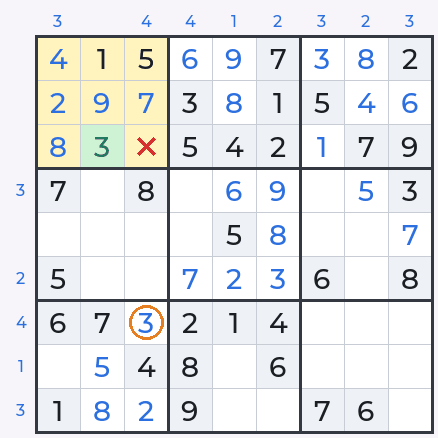

#### Step 27: the 6 in box 1

Box 1 needs a 6, and r3c3 is its last empty cell: **r3c3 = 6**.

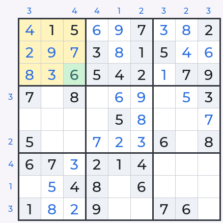

#### Step 28: the 3 in box 4

Box 4 needs a 3. r4c2: row 4 has one (r4c9). r5c2: column 2 has one (r3c2). r5c3: column 3 has one (r7c3). r6c2 and r6c3: row 6 has one (r6c6). Only **r5c1** is left: **r5c1 = 3**.

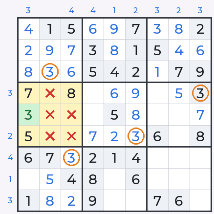

#### Step 29: the 6 in box 4

Box 4 needs a 6. r4c2: row 4 has one (r4c5). r5c3: column 3 has one (r3c3). r6c2 and r6c3: row 6 has one (r6c7). Only **r5c2** is left: **r5c2 = 6**.

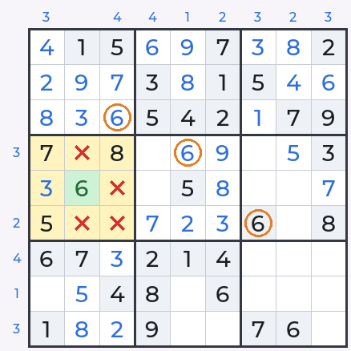

#### Step 30: the 2 in box 4

Box 4 needs a 2. r5c3: column 3 has one (r9c3). r6c2 and r6c3: row 6 has one (r6c5). Only **r4c2** is left: **r4c2 = 2**.

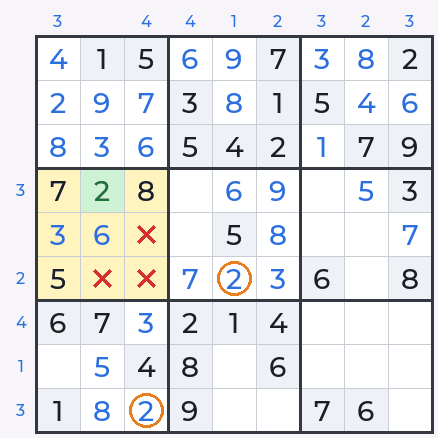

#### Step 31: the 4 in box 4

Box 4 needs a 4. r5c3 and r6c3: column 3 has one (r8c3). Only **r6c2** is left: **r6c2 = 4**.

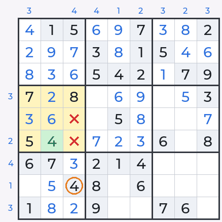

#### Step 32: the 1 in box 4

Box 4 needs a 1. r6c3: seen from the left of row 6, a 1 there would leave 5 and 7 seen and the 9 still to come, more than its clue 2. Only **r5c3** is left: **r5c3 = 1**.

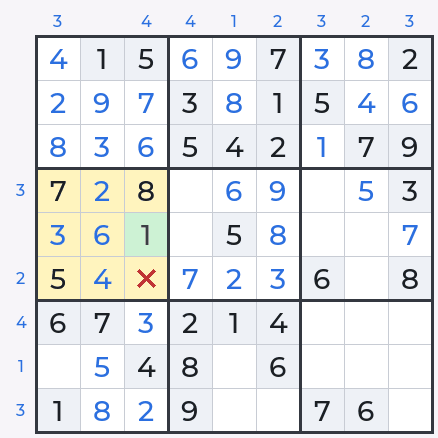

#### Step 33: the 9 in box 4

Box 4 needs a 9, and r6c3 is its last empty cell: **r6c3 = 9**.

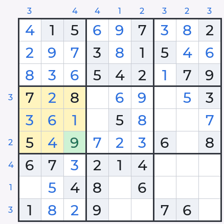

#### Step 34: the 1 in box 5

Box 5 needs a 1. r5c4: row 5 has one (r5c3). Only **r4c4** is left: **r4c4 = 1**.

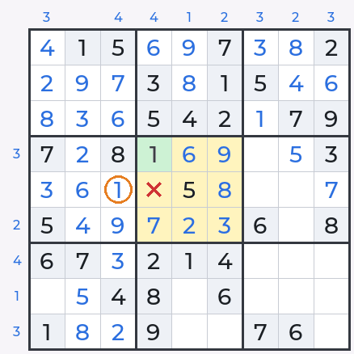

#### Step 35: the 4 in box 5

Box 5 needs a 4, and r5c4 is its last empty cell: **r5c4 = 4**.

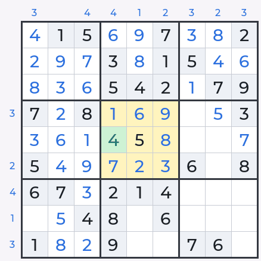

#### Step 36: the 1 in box 6

Box 6 needs a 1. r4c7: row 4 has one (r4c4). r5c7 and r5c8: row 5 has one (r5c3). Only **r6c8** is left: **r6c8 = 1**.

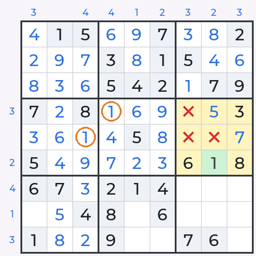

#### Step 37: the 4 in box 6

Box 6 needs a 4. r5c7 and r5c8: row 5 has one (r5c4). Only **r4c7** is left: **r4c7 = 4**.

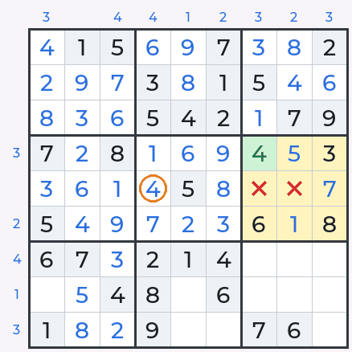

#### Step 38: the 2 in box 6

Box 6 needs a 2. r5c7: seen from the top of column 7, a 2 there would leave 3, 5 and 6 seen and the 9 still to come, more than its clue 3. Only **r5c8** is left: **r5c8 = 2**.

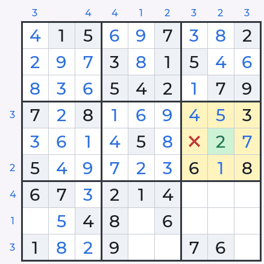

#### Step 39: the 9 in box 6

Box 6 needs a 9, and r5c7 is its last empty cell: **r5c7 = 9**.

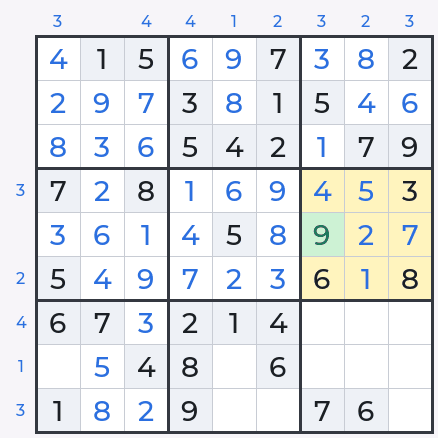

#### Step 40: the 9 in box 7

Box 7 needs a 9, and r8c1 is its last empty cell: **r8c1 = 9**.

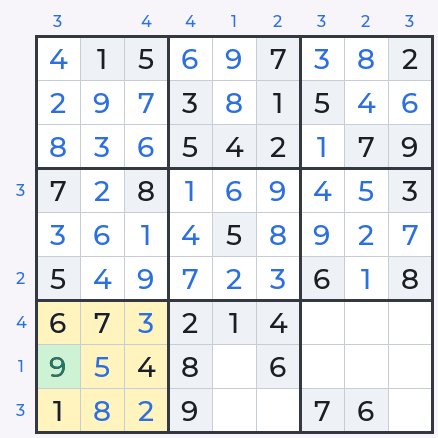

#### Step 41: the 5 in box 8

Box 8 needs a 5. r8c5: row 8 has one (r8c2). r9c5: column 5 has one (r5c5). Only **r9c6** is left: **r9c6 = 5**.

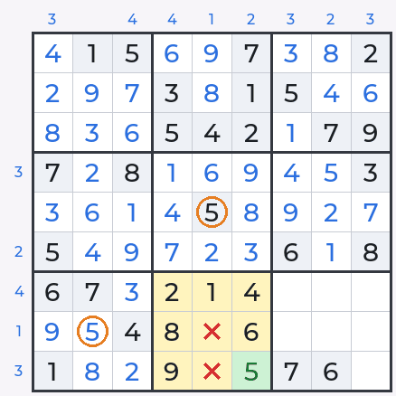

#### Step 42: the 7 in box 8

Box 8 needs a 7. r9c5: row 9 has one (r9c7). Only **r8c5** is left: **r8c5 = 7**.

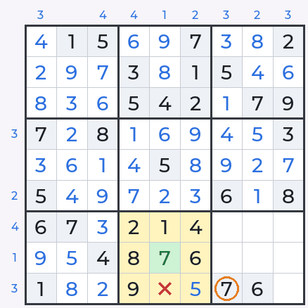

#### Step 43: the 3 in box 8

Box 8 needs a 3, and r9c5 is its last empty cell: **r9c5 = 3**.

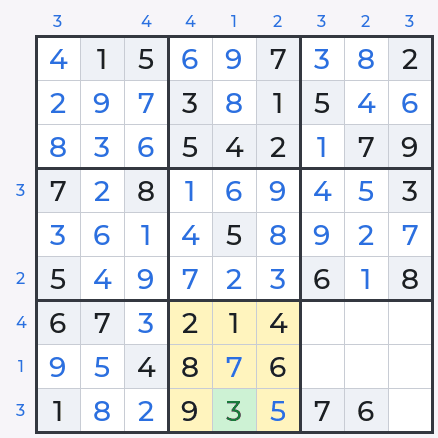

#### Step 44: the 1 in box 9

Box 9 needs a 1. r7c7, r7c8 and r7c9: row 7 has one (r7c5). r8c7: column 7 has one (r3c7). r8c8: column 8 has one (r6c8). r9c9: row 9 has one (r9c1). Only **r8c9** is left: **r8c9 = 1**.

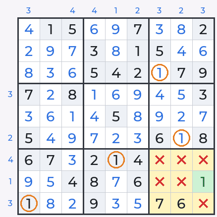

#### Step 45: the 2 in box 9

Box 9 needs a 2. r7c7, r7c8 and r7c9: row 7 has one (r7c4). r8c8: column 8 has one (r5c8). r9c9: row 9 has one (r9c3). Only **r8c7** is left: **r8c7 = 2**.

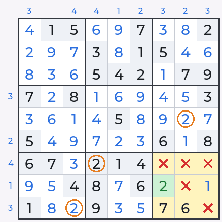

#### Step 46: the 3 in box 9

Box 9 needs a 3. r7c7, r7c8 and r7c9: row 7 has one (r7c3). r9c9: row 9 has one (r9c5). Only **r8c8** is left: **r8c8 = 3**.

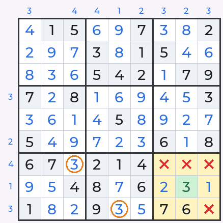

#### Step 47: the 4 in box 9

Box 9 needs a 4. r7c7, r7c8 and r7c9: row 7 has one (r7c6). Only **r9c9** is left: **r9c9 = 4**.

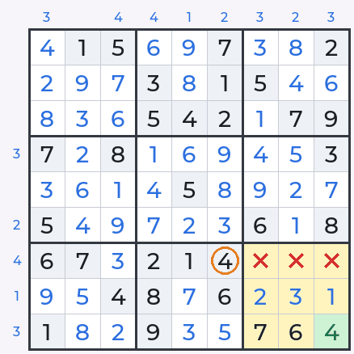

#### Step 48: the 5 in box 9

Box 9 needs a 5. r7c7: column 7 has one (r2c7). r7c8: column 8 has one (r4c8). Only **r7c9** is left: **r7c9 = 5**.

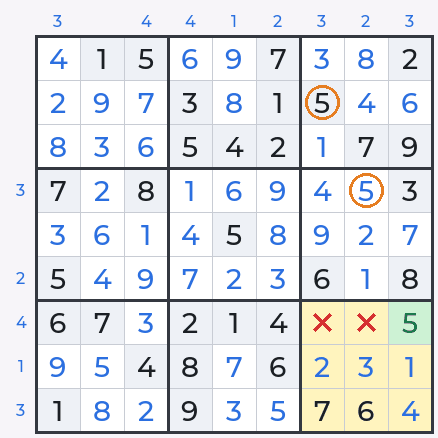

#### Step 49: the 8 in box 9

Box 9 needs an 8. r7c8: column 8 has one (r1c8). Only **r7c7** is left: **r7c7 = 8**.

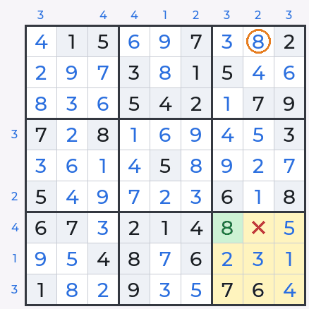

#### Step 50: the 9 in box 9

Box 9 needs a 9, and r7c8 is its last empty cell: **r7c8 = 9**.

Solved.

<!-- /walkthrough -->
