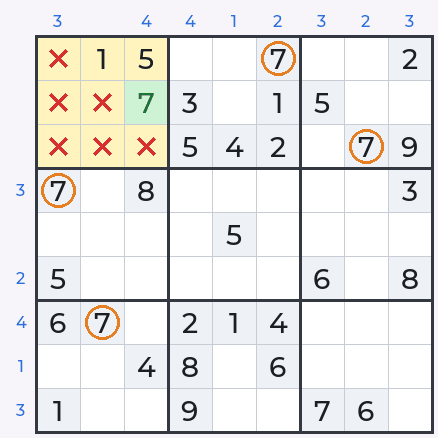

<!-- Written by tools/walkthrough.py skyscraper: edit the script, not this page. -->
# Skyscraper, step 1: the 7 in box 1

**Step 1 of 50** · [← The start](../skyscraper.md#the-whole-puzzle-step-by-step) · [All steps](../skyscraper.md#the-whole-puzzle-step-by-step) · [Step 2 →](step-02.md)

Box 1 needs a 7. r1c1: row 1 has one (r1c6). r2c1: column 1 has one (r4c1). r2c2: column 2 has one (r7c2). r3c1, r3c2 and r3c3: row 3 has one (r3c8). Only **r2c3** is left: **r2c3 = 7**.

**Step 1 of 50** · [← The start](../skyscraper.md#the-whole-puzzle-step-by-step) · [All steps](../skyscraper.md#the-whole-puzzle-step-by-step) · [Step 2 →](step-02.md)
