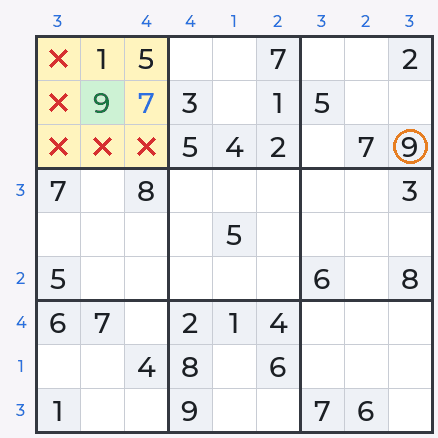

<!-- Written by tools/walkthrough.py skyscraper: edit the script, not this page. -->
# Skyscraper, step 2: the 9 in box 1

**Step 2 of 50** · [← Step 1](step-01.md) · [All steps](../skyscraper.md#the-whole-puzzle-step-by-step) · [Step 3 →](step-03.md)

Box 1 needs a 9. r3c1, r3c2 and r3c3: row 3 has one (r3c9). r1c1: it's near a clue of its row or column, which keeps it at most 7. r2c1: it's near a clue of its row or column, which keeps it at most 8. Only **r2c2** is left: **r2c2 = 9**.

**Step 2 of 50** · [← Step 1](step-01.md) · [All steps](../skyscraper.md#the-whole-puzzle-step-by-step) · [Step 3 →](step-03.md)
