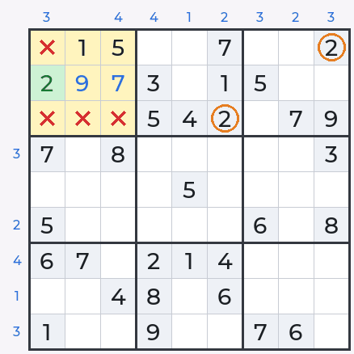

<!-- Written by tools/walkthrough.py skyscraper: edit the script, not this page. -->
# Skyscraper, step 3: the 2 in box 1

**Step 3 of 50** · [← Step 2](step-02.md) · [All steps](../skyscraper.md#the-whole-puzzle-step-by-step) · [Step 4 →](step-04.md)

Box 1 needs a 2. r1c1: row 1 has one (r1c9). r3c1, r3c2 and r3c3: row 3 has one (r3c6). Only **r2c1** is left: **r2c1 = 2**.

**Step 3 of 50** · [← Step 2](step-02.md) · [All steps](../skyscraper.md#the-whole-puzzle-step-by-step) · [Step 4 →](step-04.md)
