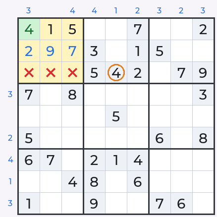

<!-- Written by tools/walkthrough.py skyscraper: edit the script, not this page. -->
# Skyscraper, step 4: the 4 in box 1

**Step 4 of 50** · [← Step 3](step-03.md) · [All steps](../skyscraper.md#the-whole-puzzle-step-by-step) · [Step 5 →](step-05.md)

Box 1 needs a 4. r3c1, r3c2 and r3c3: row 3 has one (r3c5). Only **r1c1** is left: **r1c1 = 4**.

**Step 4 of 50** · [← Step 3](step-03.md) · [All steps](../skyscraper.md#the-whole-puzzle-step-by-step) · [Step 5 →](step-05.md)
