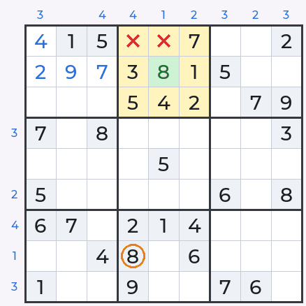

<!-- Written by tools/walkthrough.py skyscraper: edit the script, not this page. -->
# Skyscraper, step 5: the 8 in box 2

**Step 5 of 50** · [← Step 4](step-04.md) · [All steps](../skyscraper.md#the-whole-puzzle-step-by-step) · [Step 6 →](step-06.md)

Box 2 needs an 8. r1c4: column 4 has one (r8c4). r1c5: a clue of its row or column makes it a 9 (see the rules above). Only **r2c5** is left: **r2c5 = 8**.

**Step 5 of 50** · [← Step 4](step-04.md) · [All steps](../skyscraper.md#the-whole-puzzle-step-by-step) · [Step 6 →](step-06.md)
