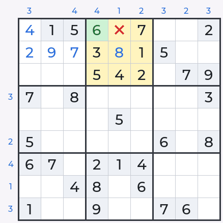

<!-- Written by tools/walkthrough.py skyscraper: edit the script, not this page. -->
# Skyscraper, step 6: the 6 in box 2

**Step 6 of 50** · [← Step 5](step-05.md) · [All steps](../skyscraper.md#the-whole-puzzle-step-by-step) · [Step 7 →](step-07.md)

Box 2 needs a 6. r1c5: a clue of its row or column makes it a 9 (see the rules above). Only **r1c4** is left: **r1c4 = 6**.

**Step 6 of 50** · [← Step 5](step-05.md) · [All steps](../skyscraper.md#the-whole-puzzle-step-by-step) · [Step 7 →](step-07.md)
