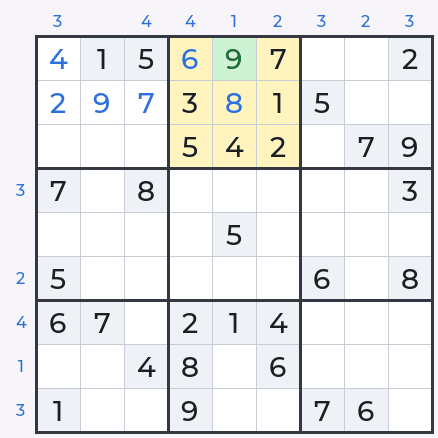

<!-- Written by tools/walkthrough.py skyscraper: edit the script, not this page. -->
# Skyscraper, step 7: the 9 in box 2

**Step 7 of 50** · [← Step 6](step-06.md) · [All steps](../skyscraper.md#the-whole-puzzle-step-by-step) · [Step 8 →](step-08.md)

Box 2 needs a 9, and r1c5 is its last empty cell: **r1c5 = 9**.

**Step 7 of 50** · [← Step 6](step-06.md) · [All steps](../skyscraper.md#the-whole-puzzle-step-by-step) · [Step 8 →](step-08.md)
