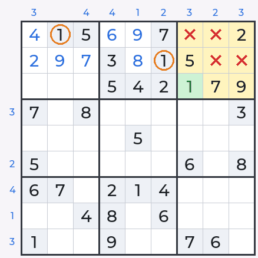

<!-- Written by tools/walkthrough.py skyscraper: edit the script, not this page. -->
# Skyscraper, step 8: the 1 in box 3

**Step 8 of 50** · [← Step 7](step-07.md) · [All steps](../skyscraper.md#the-whole-puzzle-step-by-step) · [Step 9 →](step-09.md)

Box 3 needs a 1. r1c7 and r1c8: row 1 has one (r1c2). r2c8 and r2c9: row 2 has one (r2c6). Only **r3c7** is left: **r3c7 = 1**.

**Step 8 of 50** · [← Step 7](step-07.md) · [All steps](../skyscraper.md#the-whole-puzzle-step-by-step) · [Step 9 →](step-09.md)
