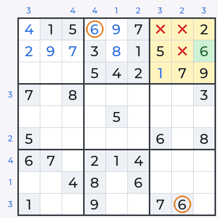

<!-- Written by tools/walkthrough.py skyscraper: edit the script, not this page. -->
# Skyscraper, step 9: the 6 in box 3

**Step 9 of 50** · [← Step 8](step-08.md) · [All steps](../skyscraper.md#the-whole-puzzle-step-by-step) · [Step 10 →](step-10.md)

Box 3 needs a 6. r1c7 and r1c8: row 1 has one (r1c4). r2c8: column 8 has one (r9c8). Only **r2c9** is left: **r2c9 = 6**.

**Step 9 of 50** · [← Step 8](step-08.md) · [All steps](../skyscraper.md#the-whole-puzzle-step-by-step) · [Step 10 →](step-10.md)
