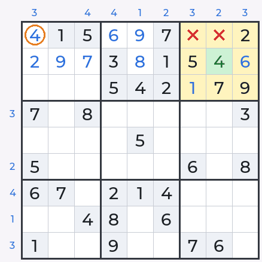

<!-- Written by tools/walkthrough.py skyscraper: edit the script, not this page. -->
# Skyscraper, step 10: the 4 in box 3

**Step 10 of 50** · [← Step 9](step-09.md) · [All steps](../skyscraper.md#the-whole-puzzle-step-by-step) · [Step 11 →](step-11.md)

Box 3 needs a 4. r1c7 and r1c8: row 1 has one (r1c1). Only **r2c8** is left: **r2c8 = 4**.

**Step 10 of 50** · [← Step 9](step-09.md) · [All steps](../skyscraper.md#the-whole-puzzle-step-by-step) · [Step 11 →](step-11.md)
