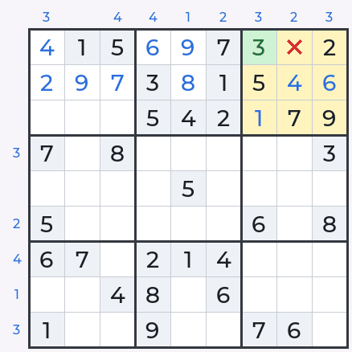

<!-- Written by tools/walkthrough.py skyscraper: edit the script, not this page. -->
# Skyscraper, step 11: the 3 in box 3

**Step 11 of 50** · [← Step 10](step-10.md) · [All steps](../skyscraper.md#the-whole-puzzle-step-by-step) · [Step 12 →](step-12.md)

Box 3 needs a 3. r1c8: seen from the top of column 8, a 3 there would leave 3, 4 and 7 seen and the 9 still to come, more than its clue 2. Only **r1c7** is left: **r1c7 = 3**.

**Step 11 of 50** · [← Step 10](step-10.md) · [All steps](../skyscraper.md#the-whole-puzzle-step-by-step) · [Step 12 →](step-12.md)
