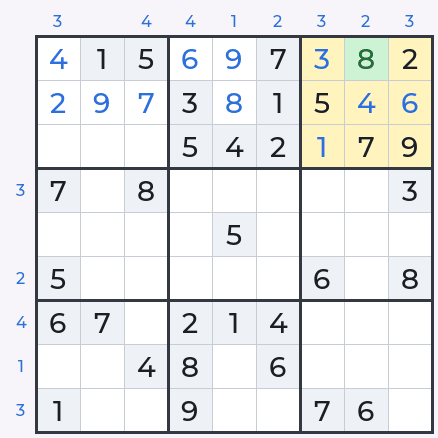

<!-- Written by tools/walkthrough.py skyscraper: edit the script, not this page. -->
# Skyscraper, step 12: the 8 in box 3

**Step 12 of 50** · [← Step 11](step-11.md) · [All steps](../skyscraper.md#the-whole-puzzle-step-by-step) · [Step 13 →](step-13.md)

Box 3 needs an 8, and r1c8 is its last empty cell: **r1c8 = 8**.

**Step 12 of 50** · [← Step 11](step-11.md) · [All steps](../skyscraper.md#the-whole-puzzle-step-by-step) · [Step 13 →](step-13.md)
