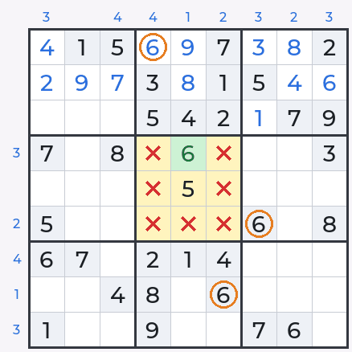

<!-- Written by tools/walkthrough.py skyscraper: edit the script, not this page. -->
# Skyscraper, step 13: the 6 in box 5

**Step 13 of 50** · [← Step 12](step-12.md) · [All steps](../skyscraper.md#the-whole-puzzle-step-by-step) · [Step 14 →](step-14.md)

Box 5 needs a 6. r4c4 and r5c4: column 4 has one (r1c4). r4c6 and r5c6: column 6 has one (r8c6). r6c4, r6c5 and r6c6: row 6 has one (r6c7). Only **r4c5** is left: **r4c5 = 6**.

**Step 13 of 50** · [← Step 12](step-12.md) · [All steps](../skyscraper.md#the-whole-puzzle-step-by-step) · [Step 14 →](step-14.md)
