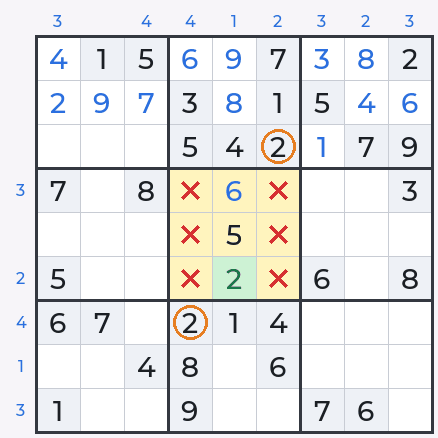

<!-- Written by tools/walkthrough.py skyscraper: edit the script, not this page. -->
# Skyscraper, step 14: the 2 in box 5

**Step 14 of 50** · [← Step 13](step-13.md) · [All steps](../skyscraper.md#the-whole-puzzle-step-by-step) · [Step 15 →](step-15.md)

Box 5 needs a 2. r4c4, r5c4 and r6c4: column 4 has one (r7c4). r4c6, r5c6 and r6c6: column 6 has one (r3c6). Only **r6c5** is left: **r6c5 = 2**.

**Step 14 of 50** · [← Step 13](step-13.md) · [All steps](../skyscraper.md#the-whole-puzzle-step-by-step) · [Step 15 →](step-15.md)
