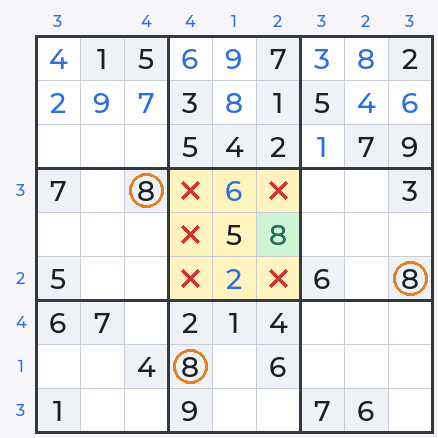

<!-- Written by tools/walkthrough.py skyscraper: edit the script, not this page. -->
# Skyscraper, step 15: the 8 in box 5

**Step 15 of 50** · [← Step 14](step-14.md) · [All steps](../skyscraper.md#the-whole-puzzle-step-by-step) · [Step 16 →](step-16.md)

Box 5 needs an 8. r4c4 and r4c6: row 4 has one (r4c3). r5c4: column 4 has one (r8c4). r6c4 and r6c6: row 6 has one (r6c9). Only **r5c6** is left: **r5c6 = 8**.

**Step 15 of 50** · [← Step 14](step-14.md) · [All steps](../skyscraper.md#the-whole-puzzle-step-by-step) · [Step 16 →](step-16.md)
