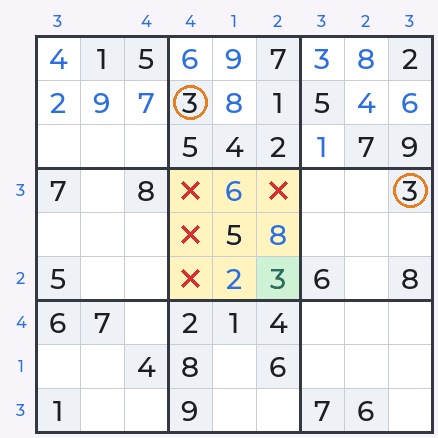

<!-- Written by tools/walkthrough.py skyscraper: edit the script, not this page. -->
# Skyscraper, step 16: the 3 in box 5

**Step 16 of 50** · [← Step 15](step-15.md) · [All steps](../skyscraper.md#the-whole-puzzle-step-by-step) · [Step 17 →](step-17.md)

Box 5 needs a 3. r4c4 and r4c6: row 4 has one (r4c9). r5c4 and r6c4: column 4 has one (r2c4). Only **r6c6** is left: **r6c6 = 3**.

**Step 16 of 50** · [← Step 15](step-15.md) · [All steps](../skyscraper.md#the-whole-puzzle-step-by-step) · [Step 17 →](step-17.md)
