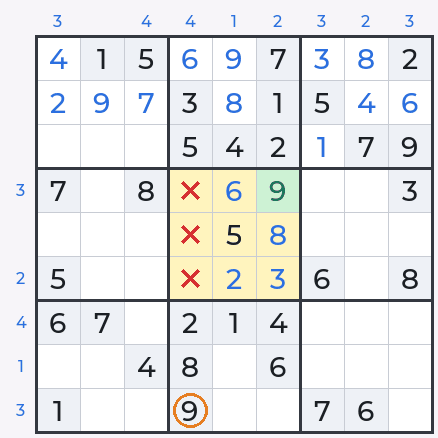

<!-- Written by tools/walkthrough.py skyscraper: edit the script, not this page. -->
# Skyscraper, step 17: the 9 in box 5

**Step 17 of 50** · [← Step 16](step-16.md) · [All steps](../skyscraper.md#the-whole-puzzle-step-by-step) · [Step 18 →](step-18.md)

Box 5 needs a 9. r4c4, r5c4 and r6c4: column 4 has one (r9c4). Only **r4c6** is left: **r4c6 = 9**.

**Step 17 of 50** · [← Step 16](step-16.md) · [All steps](../skyscraper.md#the-whole-puzzle-step-by-step) · [Step 18 →](step-18.md)
