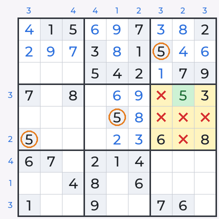

<!-- Written by tools/walkthrough.py skyscraper: edit the script, not this page. -->
# Skyscraper, step 18: the 5 in box 6

**Step 18 of 50** · [← Step 17](step-17.md) · [All steps](../skyscraper.md#the-whole-puzzle-step-by-step) · [Step 19 →](step-19.md)

Box 6 needs a 5. r4c7: column 7 has one (r2c7). r5c7, r5c8 and r5c9: row 5 has one (r5c5). r6c8: row 6 has one (r6c1). Only **r4c8** is left: **r4c8 = 5**.

**Step 18 of 50** · [← Step 17](step-17.md) · [All steps](../skyscraper.md#the-whole-puzzle-step-by-step) · [Step 19 →](step-19.md)
