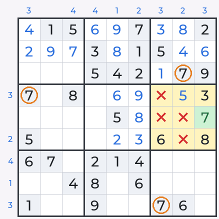

<!-- Written by tools/walkthrough.py skyscraper: edit the script, not this page. -->
# Skyscraper, step 19: the 7 in box 6

**Step 19 of 50** · [← Step 18](step-18.md) · [All steps](../skyscraper.md#the-whole-puzzle-step-by-step) · [Step 20 →](step-20.md)

Box 6 needs a 7. r4c7: row 4 has one (r4c1). r5c7: column 7 has one (r9c7). r5c8 and r6c8: column 8 has one (r3c8). Only **r5c9** is left: **r5c9 = 7**.

**Step 19 of 50** · [← Step 18](step-18.md) · [All steps](../skyscraper.md#the-whole-puzzle-step-by-step) · [Step 20 →](step-20.md)
