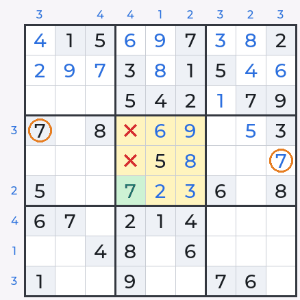

<!-- Written by tools/walkthrough.py skyscraper: edit the script, not this page. -->
# Skyscraper, step 20: the 7 in box 5

**Step 20 of 50** · [← Step 19](step-19.md) · [All steps](../skyscraper.md#the-whole-puzzle-step-by-step) · [Step 21 →](step-21.md)

Box 5 needs a 7. r4c4: row 4 has one (r4c1). r5c4: row 5 has one (r5c9). Only **r6c4** is left: **r6c4 = 7**.

**Step 20 of 50** · [← Step 19](step-19.md) · [All steps](../skyscraper.md#the-whole-puzzle-step-by-step) · [Step 21 →](step-21.md)
