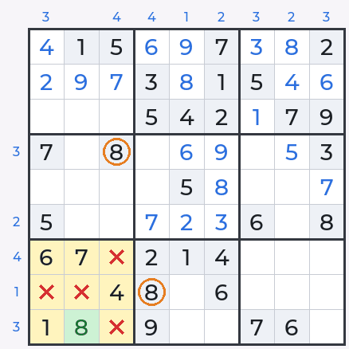

<!-- Written by tools/walkthrough.py skyscraper: edit the script, not this page. -->
# Skyscraper, step 21: the 8 in box 7

**Step 21 of 50** · [← Step 20](step-20.md) · [All steps](../skyscraper.md#the-whole-puzzle-step-by-step) · [Step 22 →](step-22.md)

Box 7 needs an 8. r7c3 and r9c3: column 3 has one (r4c3). r8c1 and r8c2: row 8 has one (r8c4). Only **r9c2** is left: **r9c2 = 8**.

**Step 21 of 50** · [← Step 20](step-20.md) · [All steps](../skyscraper.md#the-whole-puzzle-step-by-step) · [Step 22 →](step-22.md)
