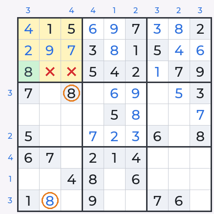

<!-- Written by tools/walkthrough.py skyscraper: edit the script, not this page. -->
# Skyscraper, step 22: the 8 in box 1

**Step 22 of 50** · [← Step 21](step-21.md) · [All steps](../skyscraper.md#the-whole-puzzle-step-by-step) · [Step 23 →](step-23.md)

Box 1 needs an 8. r3c2: column 2 has one (r9c2). r3c3: column 3 has one (r4c3). Only **r3c1** is left: **r3c1 = 8**.

**Step 22 of 50** · [← Step 21](step-21.md) · [All steps](../skyscraper.md#the-whole-puzzle-step-by-step) · [Step 23 →](step-23.md)
