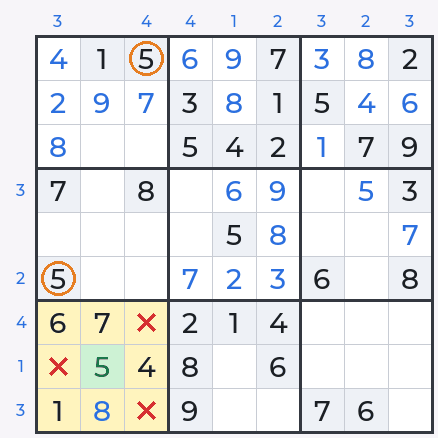

<!-- Written by tools/walkthrough.py skyscraper: edit the script, not this page. -->
# Skyscraper, step 23: the 5 in box 7

**Step 23 of 50** · [← Step 22](step-22.md) · [All steps](../skyscraper.md#the-whole-puzzle-step-by-step) · [Step 24 →](step-24.md)

Box 7 needs a 5. r7c3 and r9c3: column 3 has one (r1c3). r8c1: column 1 has one (r6c1). Only **r8c2** is left: **r8c2 = 5**.

**Step 23 of 50** · [← Step 22](step-22.md) · [All steps](../skyscraper.md#the-whole-puzzle-step-by-step) · [Step 24 →](step-24.md)
