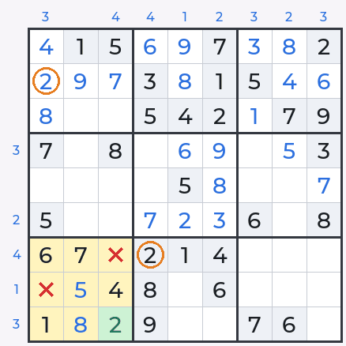

<!-- Written by tools/walkthrough.py skyscraper: edit the script, not this page. -->
# Skyscraper, step 24: the 2 in box 7

**Step 24 of 50** · [← Step 23](step-23.md) · [All steps](../skyscraper.md#the-whole-puzzle-step-by-step) · [Step 25 →](step-25.md)

Box 7 needs a 2. r7c3: row 7 has one (r7c4). r8c1: column 1 has one (r2c1). Only **r9c3** is left: **r9c3 = 2**.

**Step 24 of 50** · [← Step 23](step-23.md) · [All steps](../skyscraper.md#the-whole-puzzle-step-by-step) · [Step 25 →](step-25.md)
