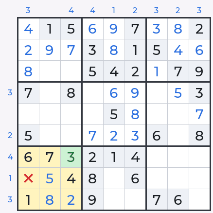

<!-- Written by tools/walkthrough.py skyscraper: edit the script, not this page. -->
# Skyscraper, step 25: the 3 in box 7

**Step 25 of 50** · [← Step 24](step-24.md) · [All steps](../skyscraper.md#the-whole-puzzle-step-by-step) · [Step 26 →](step-26.md)

Box 7 needs a 3. r8c1: a clue of its row or column makes it a 9 (see the rules above). Only **r7c3** is left: **r7c3 = 3**.

**Step 25 of 50** · [← Step 24](step-24.md) · [All steps](../skyscraper.md#the-whole-puzzle-step-by-step) · [Step 26 →](step-26.md)
