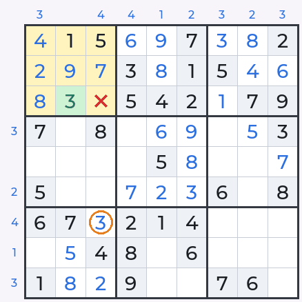

<!-- Written by tools/walkthrough.py skyscraper: edit the script, not this page. -->
# Skyscraper, step 26: the 3 in box 1

**Step 26 of 50** · [← Step 25](step-25.md) · [All steps](../skyscraper.md#the-whole-puzzle-step-by-step) · [Step 27 →](step-27.md)

Box 1 needs a 3. r3c3: column 3 has one (r7c3). Only **r3c2** is left: **r3c2 = 3**.

**Step 26 of 50** · [← Step 25](step-25.md) · [All steps](../skyscraper.md#the-whole-puzzle-step-by-step) · [Step 27 →](step-27.md)
