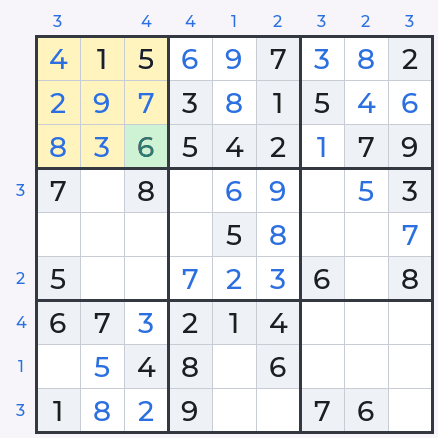

<!-- Written by tools/walkthrough.py skyscraper: edit the script, not this page. -->
# Skyscraper, step 27: the 6 in box 1

**Step 27 of 50** · [← Step 26](step-26.md) · [All steps](../skyscraper.md#the-whole-puzzle-step-by-step) · [Step 28 →](step-28.md)

Box 1 needs a 6, and r3c3 is its last empty cell: **r3c3 = 6**.

**Step 27 of 50** · [← Step 26](step-26.md) · [All steps](../skyscraper.md#the-whole-puzzle-step-by-step) · [Step 28 →](step-28.md)
